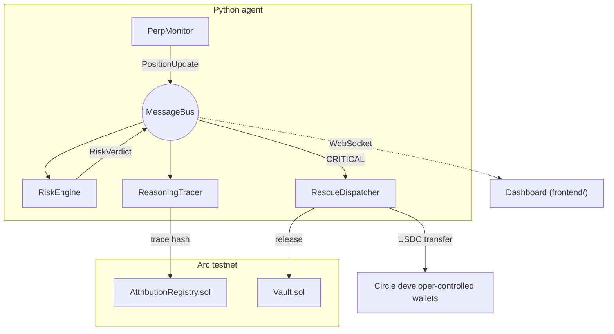

# AGORA-glass: a glass-box liquidation sentinel

An AI agent that watches leveraged perpetual-futures positions and steps in before they are liquidated. Every decision it makes is written up as a reasoning trace, and the trace's hash is stored on Circle's Arc network, so anyone can check afterwards why the agent acted.

**Live demo:** https://joethesaint.github.io/AGORA-glass/ (replays a recorded run of the agent on simulated positions; no real funds)

Built by a team of four in two weeks for the **Agora Agents hackathon** (Circle × Arc, May 2026), tracks RFB 01 (perp trading agent) and RFB 06 (social trading intelligence).

## What works today

| Part | State | Where |
| :--- | :--- | :--- |
| Message bus and events | Working, tested | `src/bus.py`, `src/events.py` |
| Position monitor | Mock feed working; live Hyperliquid feed coded, not load-tested | `src/monitor.py`, `src/market_monitor.py` |
| Risk engine | Working, tested. Caps leverage at 5x and rescues toward a 25% margin ratio (Cheng et al. 2021) | `src/engine.py`, `src/risk_math.py` |
| Reasoning tracer | Working, tested. JSON trace plus SHA-256 hash | `src/tracer.py` |
| Rescue dispatcher | Working in mock mode. Live Circle and Arc calls are coded but have not been run against real infrastructure | `src/dispatcher.py`, `src/services/` |
| Contracts | `AttributionRegistry`, `Vault` (agent-gated), `BondEscrow` | `contracts/contracts/` |
| Dashboard | Vite + React, live over WebSocket; a demo mode replays a recorded run | `frontend/` |

Not done yet: cross-chain moves through Circle Gateway, a measured live latency figure, and real users. The sub-500 ms rescue target has only been met in mock mode (`scripts/benchmark_latency.py`). See `docs/GAP_ANALYSIS.md`.

## How it works



The bus is `asyncio`-based. A subscriber that fails never stops the others; the failure is logged and published as a `SystemError` event.

## Run it

```bash
# Agent, with simulated positions (no keys needed)
uv sync
uv run python src/main.py --mode mock

# Tests
uv run pytest

# Dashboard (in another terminal)
cd frontend && npm ci && npm run dev

# Contracts
cd contracts && npm ci && npx hardhat test
```

For live mode, copy `.env.example` to `.env` and fill it in. `docs/TESTNET_GUIDE.md` covers the Arc testnet setup. Never commit `.env` or the `recovery/` folder that Circle's wallet setup creates.

## Team

| Role | Person |
| :--- | :--- |
| Agent architect (Python) | Joe ([@joethesaint](https://github.com/joethesaint)) |
| On-chain engineer (Solidity) | Ayo |
| Frontend | Andy |
| DevRel and pitch | Lani |

Team guides: `docs/team/`.

## More

- Architecture: `docs/ARCHITECTURE.md`, `docs/DIAGRAMS.md`
- Plugins and agent modes: `docs/PLUGINS_AND_AGENTS.md`
- Circle and Arc SDK notes: `docs/SDK_INTEGRATION.md`, `docs/arc_context.md`
- Hackathon tooling (`arc-canteen`): `docs/HACKATHON.md`, `docs/ARC_CLI_GUIDE.md`
